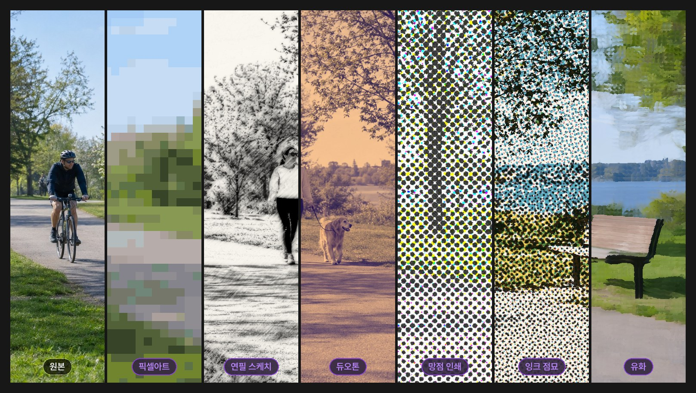
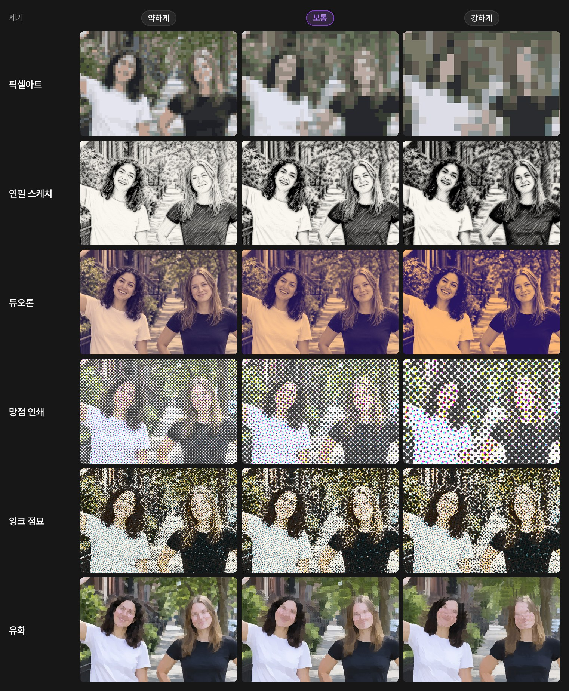
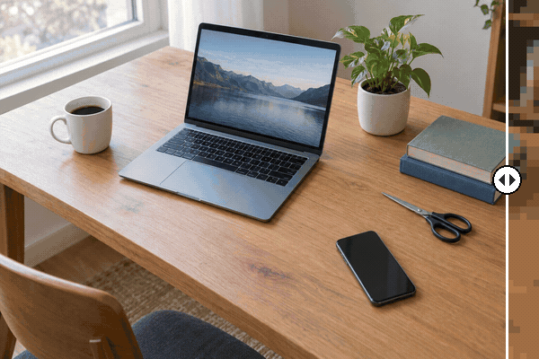
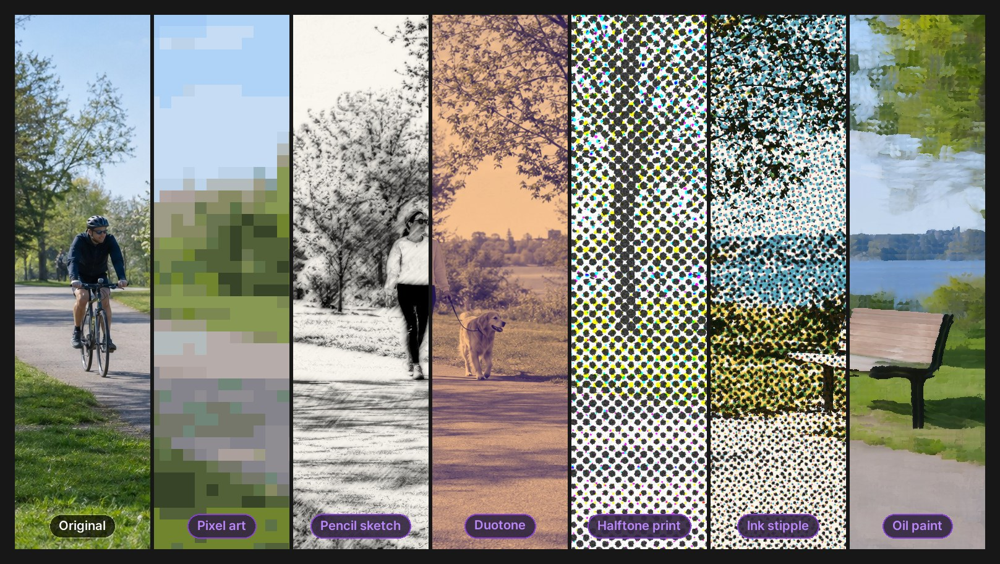
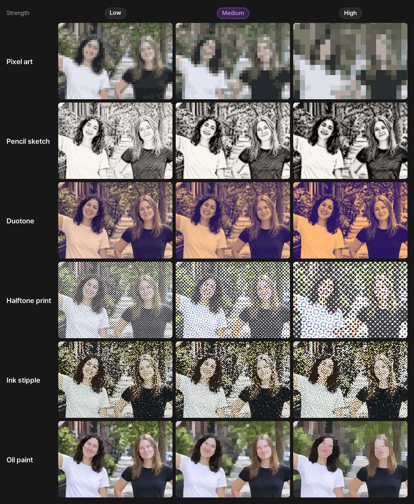

# 사진 효과 모음 · Photo Effects

PromBoard 커뮤니티 플러그인 예시입니다. 캔버스에 **사진 효과** 노드 하나를 더합니다. 사진을 이으면 고른 효과를 입혀 PNG 로 내보냅니다.



한 장의 사진을 세로 일곱 조각으로 나눠, 맨 왼쪽은 원본 그대로 두고 나머지는 효과를 하나씩 입혔습니다(세기 보통).

- 플러그인 id: `promboard.photo-effects`
- AI 모델을 받지 않습니다. 그래픽카드 없이 CPU 로 돕니다(파이썬 Pillow · numpy).
- 긴 변이 2560px 를 넘는 사진은 2560px 로 줄여서 처리합니다. 투명한 부분은 그대로 둡니다.

## 효과

| 효과 | 바꾸는 모양 | 세기(약하게 · 보통 · 강하게)가 바꾸는 것 |
|---|---|---|
| 픽셀아트 | 큰 네모 칸과 적은 색 | 칸 크기 |
| 연필 스케치 | 종이 위 연필 선과 빗금 명암 | 선 굵기 · 진하기 |
| 듀오톤 | 보라 · 살구 두 색 | 두 색을 입히는 정도 |
| 망점 인쇄 | 신문 · 만화 인쇄처럼 네 가지 잉크 색의 매끈한 점 | 점 크기 |
| 잉크 점묘 | 오래된 잡지 인쇄처럼 바랜 잉크 색 점 | 점 크기(조금씩) |
| 유화 | 붓으로 칠한 듯한 색 덩어리 | 붓 터치 크기 |



노드 위 손잡이를 끌면 원본과 결과를 나란히 견줘 볼 수 있습니다. 아래 움짤은 손잡이를 끌 때처럼 왼쪽은 원본, 오른쪽은 효과를 입힌 결과로 나눠 보여 줍니다. 효과는 픽셀아트 → 연필 스케치 → 듀오톤 → 망점 인쇄 → 잉크 점묘 → 유화 차례로 바뀝니다(세기 보통).



예시 사진은 GPT Image 2.5 로 만든 사진(Ultralytics YOLO 예시 플러그인의 예제 사진과 같음)이고, 결과는 이 저장소의 `nodes/main.py` 를 그대로 돌려 얻었습니다.

## 설치

1. PromBoard 앱 → 플러그인 매니저 → **커뮤니티 플러그인** → 둘러보기에서 「사진 효과 모음」을 설치합니다.
2. 코드가 든 플러그인이라 **제한 모드**를 끄고 플러그인을 켭니다.
3. 처음 실행할 때 실행 준비가 파이썬과 Pillow · numpy 를 받습니다(한 번만).
4. 캔버스 빈 곳을 우클릭하면 메뉴 맨 아래 플러그인 묶음에 **사진 효과**가 있습니다. 이미지 노드나 소스 이미지를 왼쪽 입력에 잇고, 노드를 골라 효과 · 세기 알약을 정한 뒤 ▷ 를 누릅니다.

## 플러그인 만드는 사람을 위한 메모

```
manifest.json            플러그인 정보 · 노드 정의(layout single + views compare)
icon.png
nodes/main.py            NODES = {"photo-effect": 함수}
nodes/requirements.in    받을 패키지(사람이 고치는 파일)
nodes/requirements-*.txt 운영체제별 해시 잠금 파일(만든 파일)
NOTICE                   망점 인쇄(glsl-halftone, MIT) · 잉크 점묘(Paper Shaders, Apache-2.0) 코드의 원본 · 연필 스케치 출처
LICENSE-APACHE           Apache-2.0 전문(잉크 점묘 코드)
docs/                    이 README 의 그림(ko · en, 움짤은 두 언어 공용). 플러그인 zip 에는 넣지 않는다
docs/scripts/            위 그림을 nodes/main.py 로 다시 만드는 스크립트(make_results.py → make_visuals.py)
```

- 잠금 파일 다시 만들기(운영체제마다 `--python-platform` 을 바꿔서):
  `uv pip compile nodes/requirements.in --generate-hashes --python-version 3.12 --python-platform x86_64-pc-windows-msvc --index-url https://pypi.org/simple -o nodes/requirements-win.txt`
- 레지스트리에 올리는 zip · 등록 항목은 PromBoard 앱 저장소의 `server/src/tools/packPlugin.ts` 로 만듭니다. `packPlugin.ts` 는 넘겨받은 폴더를 통째로 묶으므로 `git archive HEAD` 로 꺼낸 폴더를 넘깁니다. `.gitattributes` 의 `export-ignore` 로 `docs/` 가 빠집니다.
- README 그림 다시 만들기(저장소 루트에서, 잠금 파일 패키지 · ffmpeg · Pretendard 글꼴이 있는 파이썬): `python docs/scripts/make_results.py <작업 폴더> && python docs/scripts/make_visuals.py <작업 폴더> docs ko && python docs/scripts/make_visuals.py <작업 폴더> docs en hero,strength` — 예제 사진은 YOLO 예시 플러그인 저장소에서 처음 한 번 받습니다. 효과를 고치면 같은 명령으로 같은 파일 이름에 다시 만들어 함께 올립니다.

---

## English

A PromBoard community plugin example. It adds one **Photo Effect** node to the canvas: connect a photo and it outputs a PNG with the chosen effect.



One photo cut into seven vertical strips: the leftmost strip is the original, the others each have one effect applied (medium strength).

- Plugin id: `promboard.photo-effects`
- No AI model download. Runs on the CPU without a graphics card (Python Pillow + numpy).
- Photos whose long side exceeds 2560 px are downscaled to 2560 px. Transparency is kept.

| Effect | Look | Strength (low · medium · high) controls |
|---|---|---|
| Pixel art (픽셀아트) | big square cells, few colors | cell size |
| Pencil sketch (연필 스케치) | pencil lines and hatched shading on paper | line width and darkness |
| Duotone (듀오톤) | purple and apricot | how much of the two colors is applied |
| Halftone print (망점 인쇄) | smooth newspaper / comic dots in four ink colors | dot size |
| Ink stipple (잉크 점묘) | old-magazine dots in faded ink colors | dot size (small steps) |
| Oil paint (유화) | painterly color patches | brush size |



Drag the handle on the node to compare the original and the result. The animation below splits the picture the same way: original on the left, result on the right, going through Pixel art → Pencil sketch → Duotone → Halftone print → Ink stipple → Oil paint (medium strength).


The example photos were made with GPT Image 2.5 (the same photos as in the Ultralytics YOLO example plugin). The results come from running this repository's `nodes/main.py` as is; `docs/scripts/` rebuilds every picture: `python docs/scripts/make_results.py <work dir> && python docs/scripts/make_visuals.py <work dir> docs en` (repository root, a Python with the lock-file packages, ffmpeg and the Pretendard font).

**Install**: PromBoard → Plugin Manager → **Community plugins** → Browse → install "사진 효과 모음" (Photo Effects). Turn off **Restricted mode** and enable the plugin. The first run prepares Python with Pillow and numpy (once). Then right-click an empty spot on the canvas: **사진 효과** (Photo Effect) is in the plugin group at the bottom of the menu. Connect an image node or source image to its input, pick the effect and strength pills, and press ▷.

The plugin texts in the app are Korean only for now — the plugin manifest takes a single language.

## License

MIT — see [LICENSE](LICENSE). Pillow (MIT-CMU) and numpy (BSD-3-Clause) are installed from PyPI at prepare time and are not bundled.

- Halftone print is a NumPy port of [glsl-halftone](https://github.com/glslify/glsl-halftone) (Stefan Gustavson's halftone shader; MIT, with Ashima Arts simplex noise, MIT) — see [NOTICE](NOTICE).
- Ink stipple is a NumPy port of the [Paper Shaders](https://github.com/paper-design/shaders) "Halftone CMYK" shader (Vintage preset), Apache-2.0 — see [NOTICE](NOTICE) and [LICENSE-APACHE](LICENSE-APACHE).
- Pencil sketch follows Cewu Lu, Li Xu, Jiaya Jia, "Combining Sketch and Tone for Pencil Drawing Production" (NPAR 2012), written from the paper.
